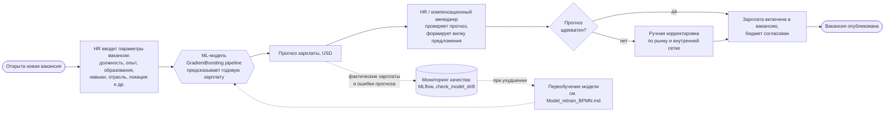
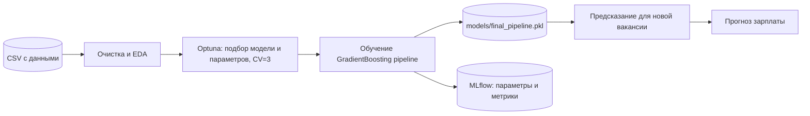

# Место модели в бизнес-процессе

Модель предсказания зарплаты встроена в процесс оценки новой вакансии в HR-отделе.

## Схема процесса

## Краткое описание

**Какую задачу в процессе решает модель.** Оценивает рыночную годовую зарплату для вакансии. Это шаг «определение зарплатного предложения» между открытием вакансии и её публикацией.

**Почему здесь целесообразно использовать ML.**
- Зарплата зависит сразу от многих факторов (опыт, должность, отрасль, размер компании, страна, формат работы), причём зависимости нелинейные и взаимодействуют друг с другом. Вручную или простой формулой их учесть трудно.
- Ручной анализ рынка занимает много времени и даёт субъективные оценки: завышенные бюджеты или потерянные кандидаты из-за низких предложений.
- Есть большой набор размеченных примеров (250 тыс. записей), на которых модель учится. Gradient Boosting показал MAPE ≈ 3 % против RMSE $35 948 у простого базлайна (медиана) и $6 842 у линейной модели.

**Какие данные поступают на вход.** 9 признаков вакансии: `job_title`, `experience_years`, `education_level`, `skills_count`, `industry`, `company_size`, `location`, `remote_work`, `certifications`. Внутри пайплайна числа масштабируются, категории кодируются One-Hot.

**Как результат используется дальше.**
- Прогноз (число в USD) показывается HR-специалисту как ориентир; окончательное решение остаётся за человеком.
- На его основе формируется зарплатная вилка вакансии и планируется ФОТ.
- Фактические зарплаты и ошибка прогноза возвращаются в мониторинг: при росте ошибки запускается процесс переобучения.

## Технический контур

Подробности о модели: `model_card.md`.
