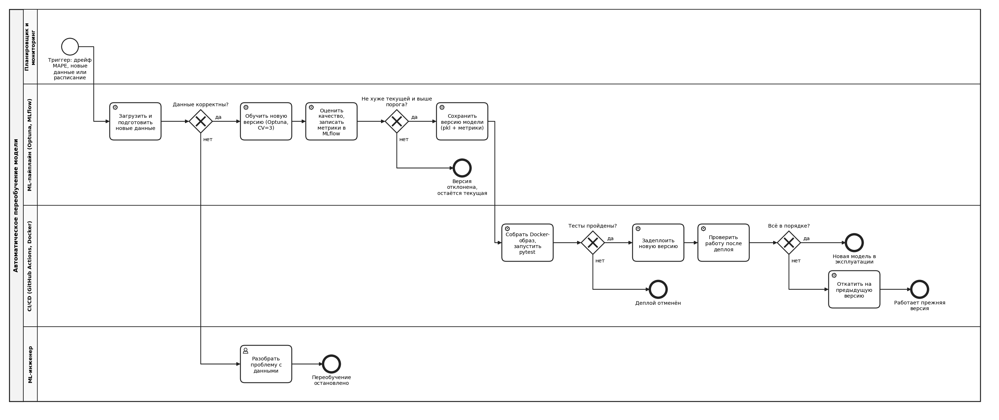

# Процесс автоматического переобучения модели

Схема описывает целевой процесс переобучения от триггера до деплоя новой версии. Уже реализовано в проекте: обучение и подбор параметров (`src/main.py`, Optuna), трекинг метрик (MLflow), проверка дрейфа (`check_model_drift` в `src/monitoring.py`), сохранение модели (`models/final_pipeline.pkl`), Docker и CI (GitHub Actions). Остальное (расписание, автодеплой, реестр версий) описано как целевое решение.

## Схема

Исходный файл схемы в формате BPMN 2.0: [diagrams/Model_retrain_BPMN.bpmn](diagrams/Model_retrain_BPMN.bpmn) (открывается в [bpmn.io](https://demo.bpmn.io/) и Camunda Modeler).

Обозначения: круг — событие (тонкий — начало, толстый — конец); скруглённый прямоугольник — задача (шестерёнка — автоматическое действие, значок человека — действие специалиста); ромб с крестом — исключающий шлюз (выбор одного пути); горизонтальные полосы — участники процесса.

## Этапы: что происходит и что передаётся дальше

| № | Этап | Что происходит | Результат для следующего шага |
|---|---|---|---|
| 1 | **Триггер** | Запуск по любому из условий: (а) `check_model_drift()` показал рост MAPE более чем на 20 % (`drift_ratio > 1.2`); (б) накопилось достаточно новых данных (например, +10 % к обучающей выборке); (в) плановый запуск раз в месяц; (г) ручной запуск | Сигнал «переобучить» и причина запуска |
| 2 | **Новые данные** | Загрузка свежих записей, объединение с имеющимися, очистка (пропуски, зарплата ≤ 0, выбросы выше 99-го перцентиля), проверка колонок и типов | Очищенный датасет; при ошибке проверки процесс останавливается |
| 3 | **Обучение** | `train_test_split` 80/20, Optuna перебирает RandomForest / GradientBoosting / Ridge (20 trials, CV=3), обучается итоговый `Pipeline` | Обученная модель-кандидат и лучшие параметры |
| 4 | **Проверка качества** | Расчёт RMSE, MAE, R², MAPE на тесте, сравнение с текущей моделью в эксплуатации, запись в MLflow | Метрики кандидата и таблица «кандидат vs текущая» |
| 5 | **Решение о публикации** | Кандидат публикуется, если: MAPE не хуже текущей модели (не более, чем на допуск) и не выше порога (например, 5 %), R² не ниже порога, модель корректно загружается и предсказывает | Решение «да / нет» |
| 6 | **Регистрация версии** | Сохранение `final_pipeline.pkl` с номером версии (например, `v1.1`), метрики и параметры фиксируются в MLflow | Зарегистрированная версия модели |
| 7 | **Деплой** | CI собирает Docker-образ, запускает `pytest`, при успехе образ выкатывается; старая версия остаётся для отката | Работающая новая версия |
| 8 | **Проверка после деплоя** | Контрольные предсказания и мониторинг MAPE на первых запросах | Подтверждение или откат |

## Действия при неуспешных проверках

- **Данные не прошли проверку** — переобучение останавливается, разработчик получает уведомление, текущая модель продолжает работать.
- **Качество новой модели хуже или ниже порога** — версия не публикуется, результаты и причина остаются в MLflow для анализа (возможно, нужно больше данных или другие признаки).
- **Тесты CI не пройдены** — деплой блокируется, в эксплуатации остаётся предыдущая версия.
- **Проблемы после деплоя** — автоматический откат на предыдущую версию.

## Условия попадания в эксплуатацию

Новая модель попадает в продакшен только если одновременно выполнено: данные корректны, метрики не хуже текущей модели и выше установленных порогов, тесты CI пройдены, контрольная проверка после деплоя успешна.
